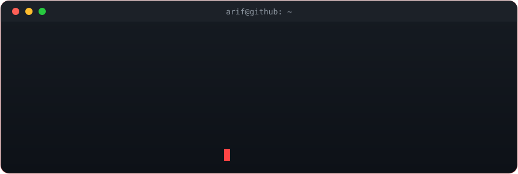
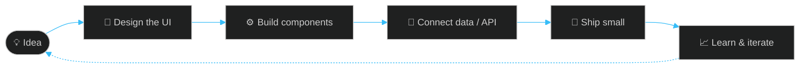
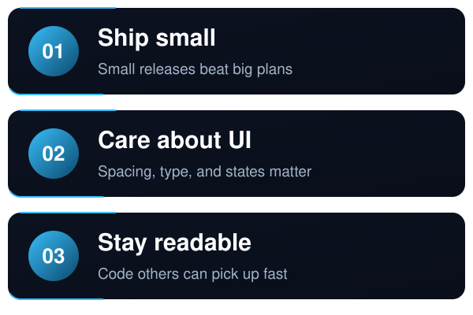

  

  

  
  
  

  
  
  

  

  

## 🧭 About me

  

> Building useful things and learning in public.

Frontend-leaning engineer who turns rough ideas into clean, fast, usable interfaces, and connects them to solid backends when a project needs it.

- 🔭 **Building:** web apps with clean UI and real utility
- 🌱 **Learning:** TypeScript, testing, performance, system design
- 💬 **Ask me about:** frontend, UI details, shipping small projects
- ⏰ **Timezone:** Asia/Jakarta (UTC+7)

## ⚡ How I build

  

## 🛠️ Core toolkit

  

  

## 🚀 Featured projects

  

> 📌 Tip: add a short description and a live demo link to every repo. Projects without one look unfinished.

## 📊 Activity

  

📈 More stats (optional)

  
  

## 🤝 Let's connect

  

  
  
  

Open to collaboration, freelance, and interesting problems. ⚡

