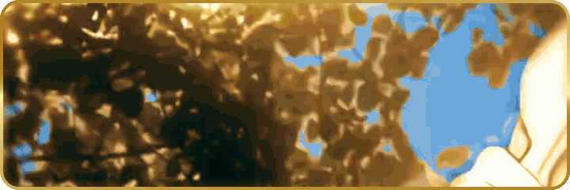
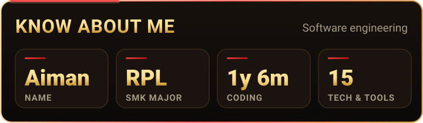
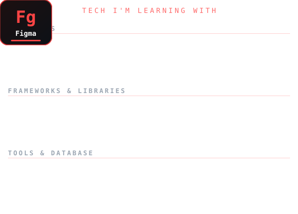
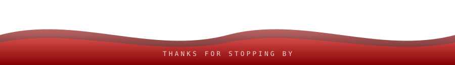

  

  

  
  
  

  
  

  

  

## 🙋 Know about me

  

Halo! Saya Aiman, pelajar SMK jurusan Rekayasa Perangkat Lunak (RPL) yang sudah mendalami dunia koding selama 1 tahun 6 bulan. Selama menempuh pendidikan di jurusan ini, saya mulai tertarik mendalami pembuatan website dan aplikasi, terutama menggunakan Java, HTML, CSS, JavaScript,PHP dan lain lain yang aku ingin coba. Tujuan saya saat ini adalah terus belajar, memperbanyak latihan proyek, dan mempersiapkan diri untuk menjadi seorang Web Developer atau pembuat aplikasi yang andal di industri teknologi.

  

## 🛠️ Core toolkit

  

  

## 🚀 Featured projects

  

> 📌 Tip: add a short description and a live demo link to every repo. Projects without one look unfinished.

## 📊 Activity

  

📈 More stats (optional)

  
  

## 🤝 Let's connect

  

  
  
  

Open to collaboration, freelance, and interesting problems. ⚡

